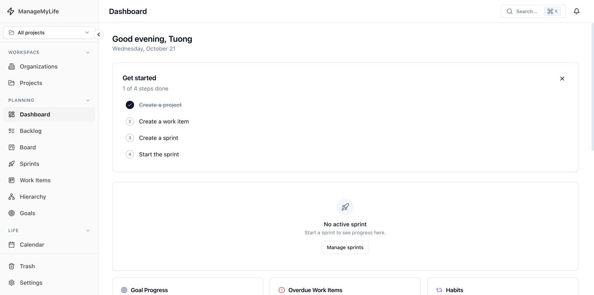
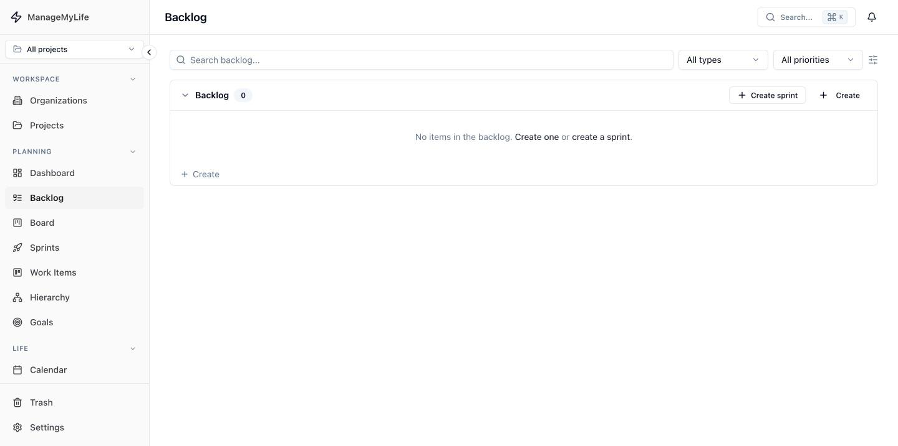
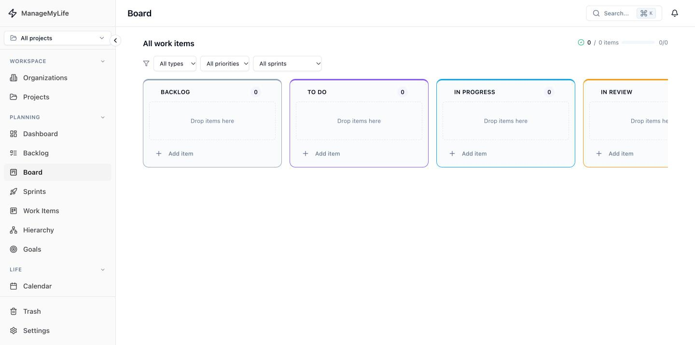
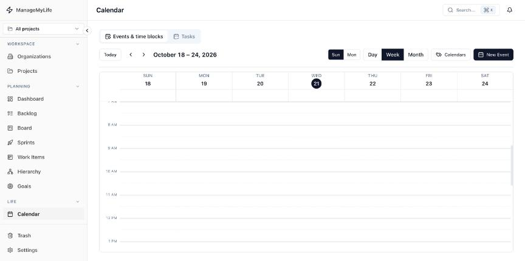
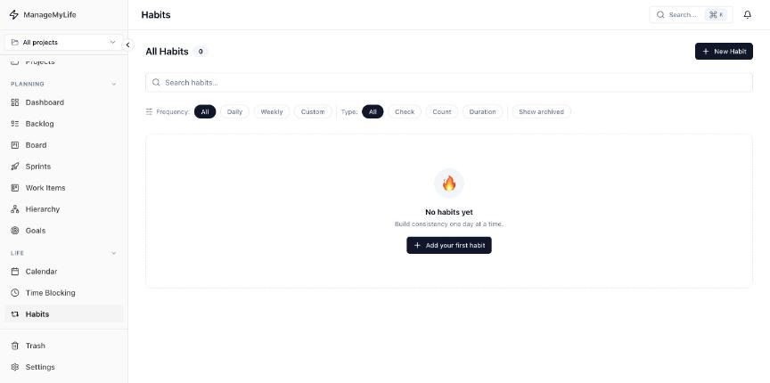
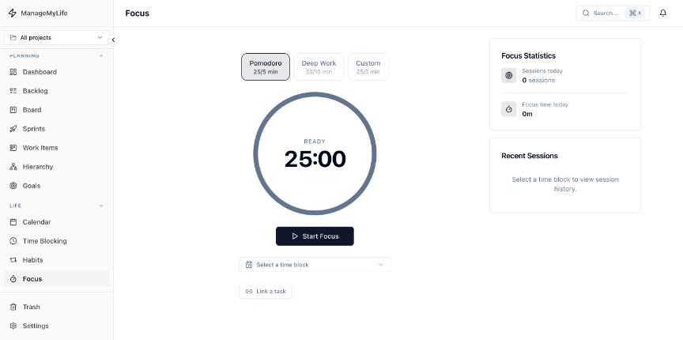
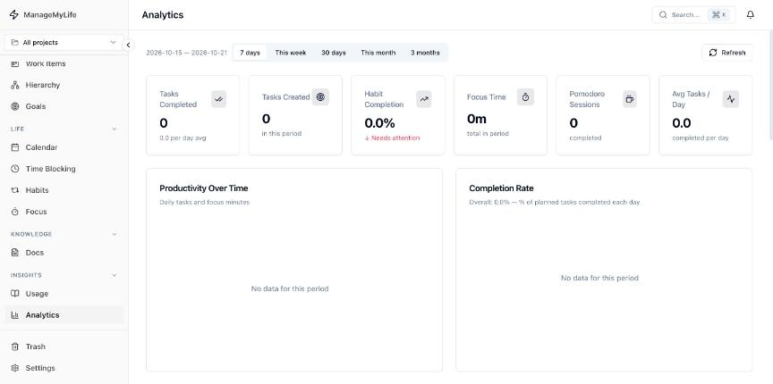
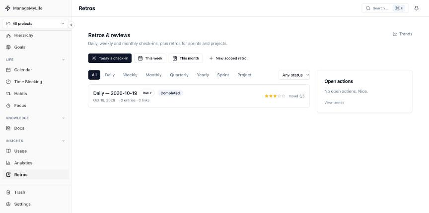

# Manage My Life

A self-hosted **personal Agile OS**: Jira-style planning (goals, epics, sprints, boards, retros) combined with the life-management tools that usually live in separate apps (calendar, time blocking, habits, focus timer, docs).

Built with a Rust (Axum) backend and a Next.js frontend. One account, one place for the work you plan and the time you actually spend.



## Features

**Planning**
- Goals → Initiatives → Epics → Work items → Subtasks, with a portfolio **Hierarchy** view and progress roll-ups
- **Backlog** and **sprints**: capacity enforcement, start/stop, rollover of unfinished items, velocity, burndown, sprint review and retrospective
- **Kanban board** with custom columns, drag and drop, and a type / priority / sprint filter
- Work items with item keys (`WI-1`), types (epic, feat, fix, docs, ...), priorities, labels, estimate systems, custom properties, attachments, links, activity log and bulk operations
- Table view with grouping, ordering, display options, per-user **saved views**
- `@mentions` and backlinks between work items, docs and retros

**Life**
- **Calendar** with recurring events, calendar types, drag-to-create and drag-to-reschedule
- **Time blocking** and a **focus** timer (Pomodoro / deep work) linked to tasks
- **Habits** with streaks, heatmap, and check / count / duration types
- **Analytics**: productivity, completion rate, focus time, velocity, time by epic

**Knowledge**
- **Docs**: spaces and pages with a rich-text editor (Tiptap), databases, comments, full-text search, and optional public pages
- **Retros**: daily, weekly, monthly, quarterly and yearly check-ins, plus sprint and project retros, templates, carry-over actions and trends

**Platform**
- Organizations and projects, soft delete with **Trash**, in-app notifications with snooze
- Real-time updates over WebSocket
- Command palette (`⌘K`) and keyboard shortcuts (`?` lists them)

## Screenshots

| | |
|---|---|
|  |  |
| **Backlog**: sprint sections and backlog | **Board**: Kanban with custom columns |
|  |  |
| **Calendar**: week / day / month | **Habits** |
|  |  |
| **Focus** timer | **Analytics** |
|  | |
| **Retros & reviews** | |

> Screenshots show a fresh account, so most views are in their empty state.

## Tech stack

| Layer | Technology |
|---|---|
| Backend | Rust, [Axum](https://github.com/tokio-rs/axum) 0.7, [SQLx](https://github.com/launchbadge/sqlx) 0.7, Tokio |
| Data | PostgreSQL 15, Redis 7 |
| Auth | JWT (HS512) access + refresh tokens, Argon2id password hashing |
| Frontend | Next.js 15 (App Router), React 19, TypeScript |
| UI | Tailwind CSS, Radix-based components, Tiptap, dnd-kit, Recharts, cmdk |
| State / data | Zustand, TanStack Query |
| Ops | Docker Compose, Nginx, Caddy (auto-TLS), Prometheus, Grafana |

## Getting started

### Option A: Docker Compose (recommended)

Requires Docker with Compose v2.

```bash
git clone https://github.com/richardnguyen0715/self_manager.git
cd self_manager

cp .env.example .env
make gen-secrets        # prints strong values for POSTGRES_PASSWORD, REDIS_PASSWORD, JWT_SECRET
# paste them into .env (replace every CHANGE_ME_*)

make up                 # build images and start everything
```

| URL | Service |
|---|---|
| http://localhost | App (via Nginx) |
| http://localhost/api | REST API |
| ws://localhost/ws | WebSocket |
| http://localhost:3001 | Grafana |
| http://localhost:9090 | Prometheus |

Open http://localhost, register an account and start planning. Database migrations run automatically when the backend starts.

### Option B: Run natively (development)

Requires Rust (stable), Node.js 20+ (or Bun), and Docker for the databases.

```bash
make dev                # starts only PostgreSQL (5432) and Redis (6379)
```

Backend:

```bash
cd backend
cp .env.example .env    # set DATABASE_URL, REDIS_URL, JWT_SECRET
cargo run               # http://localhost:8080
```

Frontend:

```bash
cd frontend
npm install
echo "NEXT_PUBLIC_API_URL=http://localhost:8080" > .env.local
npm run dev             # http://localhost:3000
```

The backend uses compile-time checked SQL. If you build without a database, set `SQLX_OFFLINE=true` and it uses the committed `backend/.sqlx` cache. After changing a query, run `cargo sqlx prepare` against a live database to refresh it.

## Configuration

Copy `.env.example` (Compose) or `backend/.env.example` (native) and adjust.

| Variable | Required | Description |
|---|---|---|
| `DATABASE_URL` | yes | PostgreSQL connection string |
| `REDIS_URL` | yes | Redis connection string |
| `JWT_SECRET` | yes | HS512 signing secret, at least 32 bytes (`openssl rand -hex 64`) |
| `POSTGRES_PASSWORD` | Compose | Password for the bundled PostgreSQL |
| `CORS_ORIGINS` | no | Comma-separated allowed origins. Empty allows any origin, so set it in production |
| `HOST` / `PORT` | no | Bind address, default `0.0.0.0:8080` |
| `ACCESS_TOKEN_TTL_SECS` | no | Default `900` (15 minutes) |
| `REFRESH_TOKEN_TTL_SECS` | no | Default `2592000` (30 days) |
| `RUST_LOG` | no | Log filter, e.g. `manage_my_life=info,tower_http=info` |
| `NEXT_PUBLIC_API_URL`, `NEXT_PUBLIC_WS_URL` | no | Public API / WebSocket URLs baked into the frontend at build time |

Uploads (avatars, attachments) are stored on the backend's local disk under `backend/uploads/`; mount a volume there if you deploy with containers.

## Deploying

Two production setups are included, see [`docker/DEPLOY.md`](docker/DEPLOY.md):

- **Public server**: `docker/docker-compose.prod.yml` with Caddy for automatic HTTPS (`make prod-env`, edit `.env`, `make prod-up`).
- **Behind your own reverse proxy** (for example Cloudflare Tunnel + Nginx): `docker/docker-compose.server.yml` binds to loopback ports only (`make server-up`). An Nginx vhost example is in `docker/nginx/example.com.conf`.

Before exposing an instance, use unique secrets, set `CORS_ORIGINS` to your own domain, and never commit `.env` files. See [SECURITY.md](SECURITY.md).

## Project structure

```
backend/
  src/main.rs          Startup, router assembly, CORS, tracing
  src/shared/          Config, AppState, errors, JWT, auth extractor, events
  src/modules/         One folder per domain (work_item, sprint, goal, retro, page, ...)
  migrations/          SQL migrations, applied at startup
  .sqlx/               Offline query cache
frontend/
  src/app/             Route pages
  src/features/        Feature-sliced hooks, components and stores
  src/components/      Shared UI and layout
  src/lib/             API client and utilities
docker/                Production and server compose files, Caddy and Nginx configs
infra/                 Nginx, Prometheus and Grafana for the dev stack
design/                Design notes and API contracts
```

Every backend module exposes `router()`, mounted under `/api/<module>` in `main.rs`. Modules communicate through a `tokio::sync::broadcast` channel of domain events (for example `WorkItemCompleted`, `SprintCompleted`), which feeds analytics, notifications and the WebSocket.

## Make targets

Run `make help` for the full list. Common ones:

| Target | Description |
|---|---|
| `make up` / `make down` | Start / stop the full stack |
| `make dev` | Start only PostgreSQL and Redis for native development |
| `make logs` | Tail all service logs |
| `make migrate` | Run pending migrations |
| `make migrate-create NAME=add_foo` | Create a new migration |
| `make fmt` / `make lint` | rustfmt + Prettier / clippy + ESLint |
| `make shell-db` | `psql` into the running database |
| `make gen-secrets` | Generate strong random secrets |

## Contributing

Issues and pull requests are welcome. See [CONTRIBUTING.md](CONTRIBUTING.md) for the workflow and [SECURITY.md](SECURITY.md) to report vulnerabilities privately.

## License

[MIT](LICENSE)
